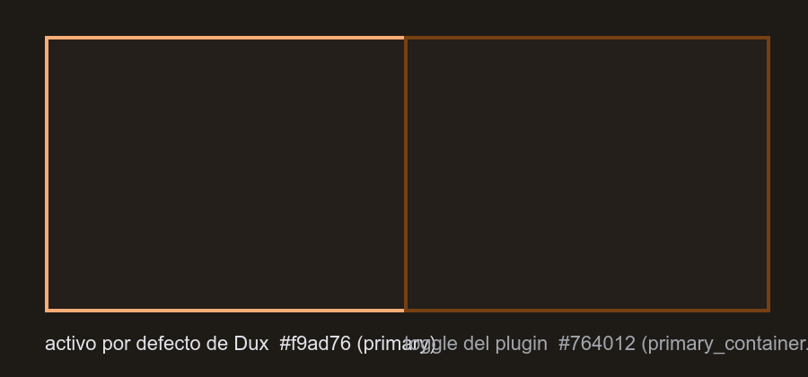

# dms-theme-sync: acople a Dux Shell 2.1.2/2.2-dev y decisión del borde de Niri

**Fecha:** 2026-11-24 · **Proyecto:** `~/Projects/dms/dms-theme-sync` (v0.15.0, rama main limpia, `a0e054e`) · **Shell instalado:** `dux-shell 2.1.2-1.1` (estable, 8-nov) · **Repo de referencia:** `~/Projects/dms/DankMaterialShell` a `v2.1.0-290-g291f4c587` (2.2-dev)

## Estado de salud (revisión completa de aspectos)

- **Versiones alineadas**: repo e instalación local ambos en **0.15.0**; árbol limpio, último commit `a0e054e` (XPI Zotero v0.1.1).
- **Ramas pendientes: ninguna** — las 6 ramas `agent/*`/`feat/qt-platform-theme-choices` ya están fusionadas en main (0 commits de diferencia).
- **Suite de tests: 4/4 en verde** (helper 1281 l., ui-contract, flatpak-overrides, xresources-backups), ejecutadas en local.
- **Sin TODOs** en el código; limitaciones documentadas como decisiones.
- IPC `dmsThemeSync status` operativo; firma de configuración reacciona con debounce de 700 ms; `Theme.matugenCompleted` conectado.

## Qué tiene tu shell instalado (2.1.2) vs el master (2.2-dev)

| Feature | 2.1.2 (tuya) | 2.2-dev (master) |
|---|---|---|
| `dms-colors.json` (45 roles ×2 + dank16) | ✓ | ✓ |
| `dms-typography.json` (5 claves) | ✓ | ✓ |
| Expressive 2025 / Classic, density, section dividers | ✓ | ✓ |
| `terminalPalette` | `default`/`high` | **4 valores: `default`/`low`/`medium`/`high`** |
| Animaciones del compositor (presets niri) | — | ✓ (11-12) |
| **Gestor de iconos de Dux** (`iconFolderRecolor`, export `icon-folders.json`, estilos de app/carpeta) | — | ✓ (11-19) |
| **kdeglobals para KDE** (Dux escribe `ColorScheme=DankMatugen` + icon-theme) | — | ✓ (11-19) |
| **Gestor de temas de cursor** (instalación/eliminación) | — | ✓ (11-20) |
| Esquinas de pantalla redondeadas (`screenCorners*`) | — | ✓ (11-21) |
| `matugenSpec` (2021/2025/dms) | ✓ | ✓ |

El patrón del plugin de sondear features (`dms20`, `dms21` con `typeof SettingsData.X`) es el correcto para acoplar 2.2 sin romper 2.1.2.

## Solapes detectados (acople necesario)

1. **`terminalPalette`** (`ThemeSyncSettings.qml:65-71`): el dropdown solo ofrece Tonal/Vibrant; Dux 2.2 ofrece 4 niveles. Gap de UI (hoy inocuo con 2.1.2, real al actualizar).
2. **`syncFolderColor` (overlay Papirus del plugin) vs gestor de iconos de Dux 2.2**: cuando actualices dux-shell, Dux recolorea carpetas nativamente (`iconFolderRecolor` + tema staged propio + `icon-folders.json`). Dos sistemas escribiendo temas de iconos = riesgo de deriva y de pelea con `checkIconThemeDrift`. El plugin debería auto-diferir y marcarse en desuso cuando el gestor de Dux exista.
3. **`syncCursorColor` (variantes Bibata por matiz) vs gestor de cursor de Dux 2.2**: mismo patrón; Dux 2.2 instala/gestiona temas de cursor. Auto-diferir cuando `cursorSettings.theme` esté gestionado por Dux.
4. **`syncKde` vs escritura de kdeglobals por Dux 2.2**: Dux 2.2 escribirá `ColorScheme=DankMatugen` + icon-theme por su cuenta; el plugin escribe lo mismo más fuentes/secciones/completo + `DankUniform`. Mismos valores objetivo → solape benigno, pero conviene documentarlo y decidir la autoridad de reconciliación.
5. **`fontScale`**: leído pero no aplicado (decisión documentada: tamaños absolutos). Sin cambio propuesto salvo decisión contraria.

## La función del borde de Niri (`dimNiriBorder`) — evaluación con datos vivos

Qué es hoy: **no atenúa nada** — sustituye el `active-color` del borde/focus-ring de la ventana enfocada por el highlight que Dux exporta (`primary_container.dark`), dejando anchos, inactive/urgent, tabs e iconos intactos. Toggle activo en tu configuración, include `dms-theme-sync.kdl` validado con rollback.

Con tu paleta Expressive actual (scheme-expressive, source saturation):

- Dux pinta el borde activo: **`#f9ad76`** (naranja vivo).
- El toggle lo sustituye por: **`#764012`** (marrón muy oscuro).

Lo que cambiaron las nuevas opciones de Dux y lo que NO cambiaron:

- **Dux 2.2 gestiona la GEOMETRÍA del borde de niri por sí mismo** (`niriLayoutBorderSize/RadiusOverride` vía `CompositorService.updateCompositorLayout`) — ancho y radio ya no son territorio del plugin (y nunca lo fueron del toggle).
- **Dux sigue sin ofrecer color de borde propio**: su template escribe siempre `active-color = primary`. El toggle del plugin **sigue siendo el único mecanismo** para variarlo — no hay opción nueva de Dux que lo sustituya.
- Con paletas Expressive la sustitución es extrema (naranja → marrón casi invisible sobre fondo oscuro); el README ya advierte que no hay pasos de tono garantizados.

:::question
¿Qué hacemos con `dimNiriBorder`?

Contexto: sigue siendo el único mecanismo para cambiar el color del borde (Dux no ofrece opción), pero con tu paleta Expressive actual el resultado es un marrón casi invisible. La imagen de arriba muestra ambos.

- [ ] Mantener tal cual — el toggle sigue siendo útil y Dux no cubre el color
- [ ] Mantener pero rediseñar la fuente del color — "primary suavizado" (primary con transparencia sobre surface, más cerca del objetivo original de atenuar) en vez del rol primary_container
- [ ] Eliminar la función — volver al primary puro de Dux y simplificar el plugin

Recommended: Mantener tal cual — el toggle sigue siendo útil y Dux no cubre el color
:::

:::question-multi
¿Qué acoples preparamos para Dux Shell 2.2 (todos con sonda de feature, activos solo al actualizar dux-shell)?

Contexto: hoy con 2.1.2 no afectan nada; al actualizar evitarán solapes y huecos.

- [ ] terminalPalette a 4 valores (Tonal/Soft/Medium/Vibrant), sondeando disponibilidad
- [ ] syncFolderColor: auto-diferir y marcar en desuso cuando exista el gestor de iconos de Dux (iconFolderRecolor)
- [ ] syncCursorColor: auto-diferir cuando exista el gestor de cursor de Dux
- [ ] Documentar el solape de kdeglobals y mantener el plugin como autoridad de reconciliación (escribe más: fuentes + secciones completas)
:::

:::question
¿Regresamos `fontScale` como escala de fuentes de apps?

Contexto: hoy los tamaños de fuente del plugin son absolutos (7-24 pt) y `fontScale` de Dux solo escala el shell. Acoplarlo haría que cambiar la escala en Dux también redimensione GTK/Qt/KDE.

- [ ] No — mantener tamaños absolutos (decisión documentada actual)
- [ ] Sí — añadir toggle "aplicar fontScale de Dux a las apps"

Recommended: No — mantener tamaños absolutos (decisión documentada actual)
:::

:::question
¿Publicamos el resultado como v0.16.0?

Contexto: el flujo de release del plugin: bump de plugin.json + CHANGELOG, commit/push a main, actualización de la entrada en dux-plugin-registry (`packaging/arqueon-dms-theme-sync.json`), y actualización de la instalación local en `~/.config/dms/plugins/dmsThemeSync` con recarga en Dux.

- [ ] Sí — bump 0.16.0 con release y registro
- [ ] No — solo commit, sin bump ni registro
:::

## Alcance técnico de lo aprobado

- Cambios en `ThemeSyncSettings.qml` (dropdown terminalPalette, avisos de desuso), `ThemeSyncService.qml` (sondas de features nuevas, firma de configuración, defers), `README.md`/`CHANGELOG.md`.
- Si se elimina el borde: retirada de setting, helper (`--dim-niri-border`), bloque kdl, sección del README y sus tests (`tests/test-helper.sh:346-403`); si se rediseña: nueva derivación de color + tests.
- Validación: suite completa + `niri validate` con rollback (borde) + recarga del plugin en Dux sin errores QML.

## Respuestas (2026-11-24)

> 4 de 4 preguntas respondidas.

1. `dimNiriBorder`: **Mantener pero rediseñar la fuente del color** — "primary suavizado" (primary con transparencia sobre surface, más cerca del objetivo original de atenuar) en vez del rol primary_container.
2. Acoples 2.2: **los cuatro** — terminalPalette a 4 valores con sonda; syncFolderColor auto-diferir + desuso cuando exista el gestor de iconos de Dux; syncCursorColor auto-diferir cuando exista el gestor de cursor; documentar el solape de kdeglobals con el plugin como autoridad de reconciliación.
3. `fontScale`: **Sí** — añadir toggle para aplicar la escala de Dux a las fuentes de las apps.
4. Publicación: **Sí** — bump v0.16.0 con release y registro.
