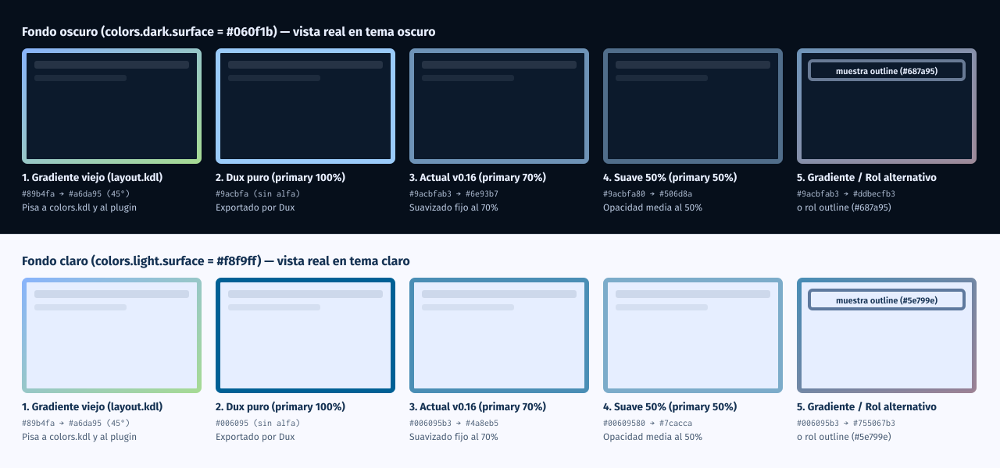

# Auditoría de `dms-theme-sync` frente a Dux Shell (2.1.2 / 2.2-dev), diagnóstico del borde de Niri y opciones de paleta

**Fecha:** 2026-11-24 · **Plugin:** `~/Projects/dms/dms-theme-sync` (v0.16.0, `9a58e90`, sincronizado sin diferencias en `~/.config/dms/plugins/dmsThemeSync`) · **Shell instalado:** `dms v2.1.2` (`dux-shell`) · **Referencia upstream:** `~/Projects/dms/DankMaterialShell` (`master` en `b92033799`, Dux 2.2-dev)

---

## 1. Estado de `dms-theme-sync` v0.16.0 frente a Dux Shell 2.1.2 y 2.2-dev

**Salud base:** La versión `0.16.0` (`9a58e90`) está instalada sin diferencias frente al repositorio, pasa las 4 suites de `tests/` (`test-flatpak-overrides.sh`, `test-helper.sh`, `test-ui-contract.sh`, `test-xresources-backups.sh`) y responde por IPC (`dms ipc call dmsThemeSync status` con `lastExitCode: 0` y `reconcile: clean`).

Sin embargo, al contrastar el plugin con el runtime de Dux `v2.1.2` y el `master` `2.2-dev` (`b92033799`) aparecen **3 bugs/deudas críticas** y **4 optimizaciones pendientes**:

### Hallazgos críticos y bugs detectados

1. **8 errores activos de deprecación en el journal (`ERROR qml: [Deprecation:28]`):**
   - Desde antes de Dux `v2.0.0` (`ccbf1d38a`), los wrappers `Dank*` de `qs.Widgets` y `DankModal` de `qs.Modals.Common` emiten `log.error` en cada arranque del shell.
   - El journal de hoy registra **8 errores** atribuibles a `dmsThemeSync`: `DankButton`, `DankTextField`, `DankActionButton`, `DankDropdown`, `DankSlider`, `DankToggle`, `DankIcon` (en `ThemeSyncSettings.qml`, `ThemeSyncDialog.qml` y `ThemeSyncWidget.qml`) y `DankModal` (`ThemeSyncDialog.qml`).
   - Son reemplazos directos por `DButton`, `DTextField`, `DActionButton`, `DDropdown`, `DSlider`, `DToggle`, `DIcon` (desde `qs.DCommon.Widgets`) y `DModal` (desde `qs.Modals.Common`). Migrarlos elimina todos los errores del journal, aunque sube el requisito real de Dux a `requires_dms: ">=2.0.0"` (Dux `1.5`/`1.6` no incluían `qs.DCommon.Widgets`).

2. **Bug real de iconos en Dux 2.2 (`resolveAppliedIconTheme()` faltante):**
   - En Dux `2.2-dev` (`Common/IconFolders.js` y `Common/SettingsData.qml:1625`), `SettingsData.iconTheme` almacena el nombre **lógico** elegido por el usuario (por ejemplo `"Papirus-Dark"` o `"dux-icons"`), mientras que el tema **real** generado en disco es `<Base>-dms-<8hex>` (publicado por `SettingsData.resolveAppliedIconTheme()` a partir de `SettingsData.iconFolderState`).
   - Hoy `ThemeSyncService.qml:61` lee directamente `SettingsData.iconTheme` y no escucha `iconFolderState`. Al actualizar a Dux `2.2` con `iconFolderRecolor` activo o con `Dux Icons` (`"dux-icons"`), el plugin sobrescribiría `qt5ct.conf`, `qt6ct.conf`, `kdeglobals`, `gtk-3.0/settings.ini`, `gsettings` y `xsettingsd` con el tema base sin recolorear o con el literal `"dux-icons"` (que no existe como directorio utilizable), y no reaccionaría al cambiar la generación del overlay.

3. **Defer incorrecto de `syncCursorColor` en Dux 2.2:**
   - La versión `0.16.0` desactiva `syncCursorColor` cuando `dms22Icons` (`typeof SettingsData.iconFolderRecolor !== "undefined"`) es verdadero (`ThemeSyncService.qml:118-119`).
   - Sin embargo, el commit `2088ad06b` de Dux `2.2-dev` (*"feat(settings): add cursor theme install and remove manager (#4340)"*) únicamente añade instalación, eliminación y vista previa multi-estado de temas de cursor (`dms cursor-theme install|remove`); **Dux 2.2 no selecciona ni cambia variantes `Bibata-Material-*` según el acento de Matugen**. Diferirlo dejaría sin efecto una función que Dux no reemplaza.

### Optimizaciones pendientes

- **Procesos redundantes al abrir ajustes y en arranque:** `ThemeSyncSettings.qml:581-699` lanza **9 `Process` en paralelo** cada vez que se abre la ventana: invoca `qtdiag6` dos veces (`qtPlatformThemesProcess` y `qtStylesProcess`), `fc-list` dos veces (`fontsProcess` y `monoFontsProcess`), y escanea carpetas de iconos y cursores que Dux ya mantiene cacheadas (`SettingsData.availableIconThemes` y `SettingsData.availableCursorThemes`). `ThemeSyncService.qml:197` repite también el escaneo de iconos al iniciar el daemon. Unificar las llamadas `qtdiag6` y `fc-list` y reutilizar las listas de Dux (con fallback cuando falten) reduce la apertura a ~4 procesos ligeros.
- **Polling innecesario de `.Xresources` en Dux 2.2+:** `ThemeSyncService.qml:294-306` ejecuta `pruneXresourcesBackups()` al arrancar y cada **60 s** para limpiar `.Xresources.backup<timestamp>`. En Dux `2.2-dev` (`9d9c9a556`), Dux ya escribe una sola copia `.Xresources.bak` si no existe; en `2.2+` basta una limpieza inicial (o al cambiar cursor) sin polling permanente.
- **Carrera residual con Niri y `Theme.onMatugenCompleted`:** `wait_for_dms_matugen_export()` (`scripts/apply-theme.sh:820-842`) espera a `gtk-4.0/dank-colors.css` y `DankMatugen*.colors`, pero **no** verifica `~/.config/niri/dms/colors.kdl`. Además, `ThemeSyncService.qml:480-490` solo re-ejecuta `runApply()` en `onMatugenCompleted` si la pasada previa vio un CSS de GTK obsoleto (`output.indexOf("Dux's exported GTK palette") !== -1`), no si el archivo obsoleto era `colors.kdl`.
- **Copy y metadatos desfasados respecto a v0.16.0:**
  - `ThemeSyncSettings.qml:796` todavía afirma *"Dux controls the wallpaper, source color and target monitor"* aunque el propio panel ya expone `Source color`.
  - `ThemeSyncSettings.qml:1261` todavía dice *"Sizes below are absolute, so Dux's UI scale does not resize application text"*, lo cual ya no es cierto cuando `applyFontScale` está activo.
  - `README.md:355-378` sigue redactado para `0.14.0` (solo documenta 2 valores de `terminalPalette` y dice que `fontScale` no se aplica).
  - `packaging/arqueon-dms-theme-sync.json` conserva `"name": "DMS Theme Sync"` y `"dependencies": ["bash"]` sin `"dbus-send"` (a diferencia de `plugin.json`).

---

## 2. Diagnóstico del color del borde en Niri (`dimNiriBorder`)



Al revisar la configuración viva en `~/.config/niri/` (`niri 26.04`) y el comportamiento de `apply-theme.sh:2021-2146`, se detectan **3 factores** que explican por qué el borde no funciona exactamente como se pensó:

1. **Conflicto activo en `~/.config/niri/layout.kdl:87-93` (repositorio `lnk`):**
   - Tu `layout.kdl` base declara dentro de `focus-ring`:
     ```kdl
     active-gradient from="#89b4fa" to="#a6da95" angle=45
     inactive-gradient from="#3A3A3E" to="#808080" angle=45 relative-to="workspace-view"
     ```
   - En Niri, `active-gradient` e `inactive-gradient` **tienen precedencia sobre `active-color` / `inactive-color`**. Los includes cargados después (`dms/colors.kdl`, `dms-theme-sync.kdl` y `user-common.kdl`) únicamente escriben `active-color` / `inactive-color` y no anulan los gradientes de `focus-ring`.
2. **Doble marco (`focus-ring` + `border`) activo a la vez:**
   - `layout.kdl:100-105` dejó `/-border` comentado con la intención de usar únicamente `focus-ring`.
   - Sin embargo, `dms/colors.kdl` (en `niri-colors.kdl`) y `dms/layout.kdl` (`niriLayoutBorderSize: 6` en `~/.config/dms/settings.json`) declaran `border { width 6 }` sin `off`, habilitando `border` además de `focus-ring` (con `width 6` en ambos y `#9acbfab3` en ambos).
3. **Limitaciones del propio `dimNiriBorder` en `0.16.0`:**
   - Hoy el toggle solo ofrece encendido/apagado con opacidad fija `0xb3` (70%), sin poder ajustar intensidad (por ejemplo 40–90%), elegir otro rol de paleta (`secondary`, `outline`, `primary_container`) ni generar un gradiente dinámico (`primary → secondary`) que sustituya explícitamente al gradiente fijo de `layout.kdl`.
   - Tampoco espera en `wait_for_dms_matugen_export()` a que `niri/dms/colors.kdl` esté actualizado antes de leer `niri_dms_active_color border`.

---

## 3. Las cuatro opciones de paleta (`Material palette`, `Matugen palette`, `Source color`, `Derived color`)

Comparativa entre `ThemeColorsTab.qml` de Dux Shell y `ThemeSyncSettings.qml` actual de `dms-theme-sync`:

| Opción en Dux | Estado actual en `dms-theme-sync` | Gap / mejora posible | Viabilidad técnica |
| --- | --- | --- | --- |
| **Material palette** (`matugenSpec`) | Dropdown (`Standard (2021)` / `Expressive (2025)` / `Bold (Dux 2025)`) visible siempre que `matugenAvailable` | Convertir a selector segmentado `DButtonGroup` (`2021` / `2025` / `dms`) y ocultarlo cuando el tema activo no sea `dynamic` | Directa (`DButtonGroup` existe en `qs.DCommon.Widgets` en 2.1.2 y 2.2) |
| **Matugen palette** (`matugenScheme`) | Dropdown de texto simple con filtro `spec2025` / `scheme-smart` | Mostrar **muestras tri-color en vivo** (`primary` / `secondary` / `tertiary` con `MatugenPreviewService.schemeOptions` + `DPaletteSwatch`) o selector enriquecido, con fallback si el preview no está listo | Directa (`MatugenPreviewService` está en `qs.Services` y `DPaletteSwatch` en `qs.DCommon.Widgets` en 2.1.2 y 2.2) |
| **Source color** (`matugenSourceMode`) | Dropdown con `Theme.availableSourceModes`, deshabilitado solo por `customSeed` | También debe deshabilitarse cuando no hay imagen de fondo (`!Theme.rawWallpaperPath`), igual que Dux (`ThemeColorsTab.qml:389`), y simplificar `onValueChanged` (quita un check innecesario en líneas 876-878) | Directa |
| **Derived color** (`matugenSeedColor`) | Renombrado *"Palette seed"*; **solo lectura** (solo muestra hex y botón limpiar; manda a Dux Settings para elegir color) | Implementar el flujo completo de `ThemeColorsTab.qml:401-433`: selector *From wallpaper* / *Custom* + swatch clickeable que abre `PopoutService.colorPickerModal` | **100% implementable** (`PopoutService.colorPickerModal` es la misma API pública usada por `Modules/Plugins/ColorSetting.qml` en Dux) |

---

## 4. Catálogo de opciones adicionales implementables desde Dux Shell

| Bloque | Opciones disponibles en Dux | Qué aporta en `dms-theme-sync` | Alcance / Compatibilidad |
| --- | --- | --- | --- |
| **A — Alta cohesión** *(paleta, modo, fuentes, apps)* | • **Tema custom y variantes del registro** (`customThemeFile`, `registryThemeVariants`)<br>• **Matugen source display** (`matugenTargetMonitor`, hoy `"HDMI-A-1"`) y **Generate theme at startup** (`generateThemeAtStartup`)<br>• **Modo claro/oscuro automático completo** (`Manual` / `Schedule` / `Location` / `Wallpaper`, unificando el actual toggle *Smart mode*)<br>• **Terminal y portal** (`terminalOpacity`, `terminalsAlwaysDark`, `syncModeWithPortal`)<br>• **Peso y escala tipográfica de Dux** (`fontWeight` 100–900, `fontScale` 75–150%)<br>• **Acciones directas en avisos de templates** (`runDmsMatugenTemplates`, `matugenTemplateGtk`, `matugenTemplateKcolorscheme`, `matugenTemplateNiri`) | Completa el espejo de apariencia y evita saltar a Dux Settings para ajustes que alimentan directamente la propagación del plugin (`fontWeight`, `fontScale`, `terminalOpacity`, exports necesarios). | Disponible ya en **Dux 2.1.2** y **2.2-dev** (todas por API pública `SettingsData` / `SessionData` / `Theme`). |
| **B — Chrome del shell** *(superficies y acentos)* | • **Acentos del shell**: `containerSaturation` (0–200%), `buttonColorMode`, `controlCenterTileColorMode`<br>• **Roles de superficie**: `hostSurfaceColor`, `cardSurfaceColor`, `chipSurfaceColor`, `chipSurfaceNestedColor`, `tooltipSurfaceColor`<br>• **Efectos de superficie**: `popupTransparency`, `blurBorder*`, `focusRing*` | Permite ajustar contraste y tintes propios de Dux sin salir del plugin, pero **no** se propagan a aplicaciones GTK/Qt/KDE. | Disponible en **Dux 2.1.2** y **2.2-dev**; aumenta el tamaño del panel de ajustes. |
| **C — Exclusivas Dux 2.2** *(sondeadas por feature)* | • **Iconos nativos Dux 2.2**: `iconFolderRecolor` y estilo básico de `Dux Icons` (`iconShape`, `iconAppStyle`, `iconGradient`, `iconTileColor`, `iconFileStyle`)<br>• **Esquinas de pantalla redondeadas**: `screenCornersEnabled`, `screenCornerRadius`, `screenCornersOverFullscreen`<br>• **Animaciones del compositor**: `compositorAnimationPreset`, `compositorAnimationSlowdown` | Evita que el panel quede mudo tras actualizar a Dux 2.2, activando controles solo cuando la propiedad existe en `SettingsData`. | Requiere **Dux 2.2+**; en 2.1.2 permanecen ocultas por feature probe. |

---

## 5. Decisiones y alcance

:::question-multi
¿Qué correcciones técnicas y optimizaciones de la Sección 1 aplicamos?

Contexto: los 8 errores `Dank*` ya aparecen en tu journal de hoy (`v2.1.2`), y los dos bugs de iconos/cursor afectan el comportamiento al actualizar a Dux `2.2`. Ninguna opción cambia la apariencia visual actual en `2.1.2`.

- [ ] Migrar widgets Dank* a D* y DModal — elimina los 8 ERROR de deprecación en el journal y sube `requires_dms` a `>=2.0.0`
- [ ] Corregir acople de iconos Dux 2.2 — usar `SettingsData.resolveAppliedIconTheme()` con `iconFolderState` y etiqueta `Dux Icons`
- [ ] Restaurar syncCursorColor en Dux 2.2 — quitar el defer erróneo porque Dux 2.2 solo instala/elimina cursores y no los recolorea
- [ ] Optimizar procesos y esperas — fusionar `qtdiag6` y `fc-list`, reutilizar listas cacheadas de Dux, reducir polling `.Xresources` en 2.2+ y esperar `niri/dms/colors.kdl` en `wait_for_dms_matugen_export`
- [ ] Actualizar documentación y packaging — alinear `ThemeSyncSettings.qml`, `README.md` y `packaging/arqueon-dms-theme-sync.json`

Recommended: Migrar widgets Dank* a D* y DModal, Corregir acople de iconos Dux 2.2, Restaurar syncCursorColor en Dux 2.2, Optimizar procesos y esperas and Actualizar documentación y packaging
:::

:::question
¿Qué hacemos con el color del borde de Niri (`dimNiriBorder`) en el plugin?

Contexto: hoy en `0.16.0` aplica un alfa fijo de 70% (`b3`) sobre `primary`, pero `dms/colors.kdl` aún no entra en la espera de `wait_for_dms_matugen_export()` y no hay selector de opacidad, rol de paleta ni gradiente dinámico.

- [ ] Mantener primary suavizado fijo (70% alfa b3) — conservar la derivación de v0.16.0 y corregir solo la espera de `niri/dms/colors.kdl`
- [ ] Evolucionar a control de borde configurable — añadir modo (Dux puro / Primary con opacidad ajustable 30–100% / Rol de paleta `secondary`, `outline` o `primary_container` / Gradiente dinámico `primary→secondary`)
- [ ] Eliminar el override de borde del plugin — dejar que Dux pinte el `primary` puro en `niri/dms/colors.kdl`

Recommended: Evolucionar a control de borde configurable
:::

:::question
¿Limpiamos el conflicto heredado en `~/.config/niri/layout.kdl` (repositorio `lnk`)?

Contexto: `layout.kdl:87-93` tiene `active-gradient` (`#89b4fa → #a6da95`) sin comentar en `focus-ring`, lo que pisa el `active-color` de `dms/colors.kdl` y del plugin; además `dms/layout.kdl` activa `border { width 6 }` aunque `layout.kdl` comentó `/-border`.

- [ ] Comentar gradientes y dejar un solo marco — editar `layout.kdl` en `lnk` para comentar `active-gradient`/`inactive-gradient` y definir explícitamente un solo marco (`focus-ring` o `border`), validando con `niri validate`
- [ ] Solo comentar gradientes en layout.kdl — quitar `active-gradient`/`inactive-gradient` en `lnk` sin tocar la configuración de `border`/`focus-ring`
- [ ] No tocar layout.kdl por ahora — dejar `lnk` intacto y ajustar únicamente el plugin

Recommended: Solo comentar gradientes en layout.kdl
:::

:::question-multi
¿Qué mejoras aplicamos a las 4 opciones principales (`Material palette`, `Matugen palette`, `Source color`, `Derived color`)?

Contexto: hoy las 3 primeras existen como dropdowns de texto y **Derived color** (*Palette seed*) es de solo lectura. Todas pueden implementarse con APIs nativas ya presentes en Dux `2.1.2`.

- [ ] Implementar Derived color interactivo — selector *From wallpaper* / *Custom* con `PopoutService.colorPickerModal` para `matugenSeedColor`
- [ ] Mejorar Matugen palette con muestras en vivo — mostrar swatches tri-color con `MatugenPreviewService.schemeOptions` y `DPaletteSwatch` (con fallback)
- [ ] Cambiar Material palette a DButtonGroup — botones segmentados `2021` / `2025` / `dms` como en Dux
- [ ] Pulir Source color y visibilidad dinámica — ligar `enabled` a `!!Theme.rawWallpaperPath`, limpiar `onValueChanged` y ocultar controles dinámicos fuera de tema `dynamic`

Recommended: Implementar Derived color interactivo, Mejorar Matugen palette con muestras en vivo, Cambiar Material palette a DButtonGroup and Pulir Source color y visibilidad dinámica
:::

:::question-multi
¿Cuáles opciones adicionales del Bloque A (alta cohesión con paleta, modo, tipografía y apps; disponibles ya en `2.1.2`) añadimos?

Contexto: todas usan APIs estables ya existentes en tu Dux `2.1.2` y complementan directamente lo que el plugin sincroniza.

- [ ] Temas custom y variantes del registro — selector de JSON custom (`customThemeFile`) y variantes `flavor`/`accent` de `registryThemeVariants`
- [ ] Monitor origen y generación al inicio — selector `matugenTargetMonitor` y toggle `generateThemeAtStartup`
- [ ] Control automático completo de modo claro/oscuro — selector `Manual` / `Schedule` / `Location` / `Wallpaper` en lugar del toggle aislado *Smart mode*
- [ ] Terminal y portal completos — slider `terminalOpacity` más toggles `terminalsAlwaysDark` y `syncModeWithPortal`
- [ ] Controles de peso y escala tipográfica Dux — sliders de `fontWeight` y `fontScale` junto a las opciones de fuentes
- [ ] Acciones directas en avisos de templates — permitir habilitar `runDmsMatugenTemplates`, GTK, KColorScheme o Niri directamente desde los avisos
:::

:::question-multi
¿Incluimos opciones de los Bloques B (chrome de Dux) o C (exclusivas de Dux 2.2)?

Contexto: el Bloque B afecta únicamente la apariencia interna de Dux (no se propaga a GTK/Qt/KDE); el Bloque C permanece oculto en `2.1.2` hasta que actualices a `2.2`.

- [ ] Colores de acento del shell — `containerSaturation`, `buttonColorMode` y `controlCenterTileColorMode`
- [ ] Roles de superficie del shell — `hostSurfaceColor`, `cardSurfaceColor`, `chipSurfaceColor`, `chipSurfaceNestedColor` y `tooltipSurfaceColor`
- [ ] Controles nativos de iconos Dux 2.2 — `iconFolderRecolor` y estilo básico de `Dux Icons` sondeados por feature
- [ ] Esquinas de pantalla redondeadas Dux 2.2 — `screenCornersEnabled`, `screenCornerRadius` y `screenCornersOverFullscreen` sondeados por feature
- [ ] Ninguna de estas — mantener el panel centrado en paleta, tipografía y propagación a apps

Recommended: Controles nativos de iconos Dux 2.2
:::

:::question
¿Cómo procedemos una vez aprobado este expediente?

Contexto: determina si tras tus respuestas aplicamos los cambios ahora mismo y si publicamos nueva versión o solo probamos en local.

- [ ] Registrar decisiones solamente — guardar las respuestas en `.revision/` y Hindsight y posponer la edición a otra sesión
- [ ] Implementar y validar localmente — aplicar lo aprobado y pasar los tests locales sin bump de versión ni recarga
- [ ] Implementar, validar y publicar v0.17.0 — aplicar lo aprobado, pasar los 4 tests + `shellcheck`, publicar bump `v0.17.0`, sincronizar `~/.config/dms/plugins/dmsThemeSync` y recargar el plugin en Dux

Recommended: Implementar, validar y publicar v0.17.0
:::

## Respuestas (2026-11-24)

> 7 of 7 questions answered (`decision: "annotated"`).

```markdown
### Q1. ¿Qué correcciones técnicas y optimizaciones de la Sección 1 aplicamos? (line 89)
Answer (your recommendation):
- Migrar widgets Dank* a D* y DModal
- Corregir acople de iconos Dux 2.2
- Restaurar syncCursorColor en Dux 2.2
- Optimizar procesos y esperas
- Actualizar documentación y packaging

### Q2. ¿Qué hacemos con el color del borde de Niri (`dimNiriBorder`) en el plugin? (line 103)
Answer: Evolucionar a control de borde configurable (your recommendation)

### Q3. ¿Limpiamos el conflicto heredado en `~/.config/niri/layout.kdl` (repositorio `lnk`)? (line 115)
Answer: Other: Si que se limpie y que se pueda seleccionar correctamente con un override desde dms-theme-sync

### Q4. ¿Qué mejoras aplicamos a las 4 opciones principales (`Material palette`, `Matugen palette`, `Source color`, `Derived color`)? (line 127)
Answer:
- Implementar Derived color interactivo
- Mejorar Matugen palette con muestras en vivo
- Cambiar Material palette a DButtonGroup
- Pulir Source color y visibilidad dinámica
- Other: Recuerda no cambiar las opciones por default de dux shell, creamos nuevas ajustadas

### Q5. ¿Cuáles opciones adicionales del Bloque A (alta cohesión con paleta, modo, tipografía y apps; disponibles ya en `2.1.2`) añadimos? (line 140)
Answer:
- Temas custom y variantes del registro
- Monitor origen y generación al inicio
- Control automático completo de modo claro/oscuro
- Terminal y portal completos
- Controles de peso y escala tipográfica Dux
- Acciones directas en avisos de templates

### Q6. ¿Incluimos opciones de los Bloques B (chrome de Dux) o C (exclusivas de Dux 2.2)? (line 153)
Answer:
- Colores de acento del shell
- Roles de superficie del shell
- Controles nativos de iconos Dux 2.2
- Esquinas de pantalla redondeadas Dux 2.2

### Q7. ¿Cómo procedemos una vez aprobado este expediente? (line 167)
Answer: Implementar, validar y publicar v0.17.0 (your recommendation)
```
