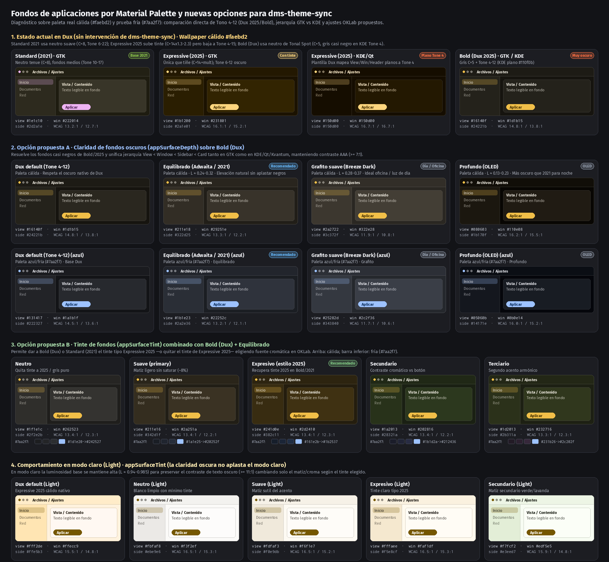

# Fondos de aplicaciones según Material Palette y nuevas opciones para `dms-theme-sync` (2026-11-24)

## 1. Diagnóstico: por qué `Expressive (2025)` tiñe los fondos y por qué `Bold (Dux)` se ve tan oscuro

Al revisar el generador interno de **Dux Shell** (`core/internal/matugen/spec.go` y `dux-go/material/dynamic/{specs.go,material_2025.go}`) junto con las plantillas que alimentan GTK y KDE (`gtk-colors.css`, `dark-kcolorscheme.colors`), se observan dos causas concretas:

1. **Por qué solo `Expressive (2025)` tiñe los fondos de las apps:**
   - **Standard (2021):** `NeutralPalette` usa croma muy bajo (`6.0–10.0` según el esquema) sin multiplicador de croma en contenedores (`1.0×`).
   - **Expressive (2025):** en la especificación 2025 de Material 3 (`PlatformPhone`), `NeutralPalette` sube el croma a **`14.0`** en oscuro (`18.0` en claro; `28.0` en `Vibrant`) y los roles `surface_container_low` / `surface_container` / `surface_container_high` / `surface_container_highest` aplican un **`ChromaMultiplier` de `1.15×` a `2.3×`**.
   - **Bold (`SpecDMS`):** conserva los acentos saturados de 2025, pero **reemplaza `NeutralPalette` por el neutro de `VariantTonalSpot` en teléfono (`chroma = 5.0`, gris casi neutro)**, eliminando el tinte ambiental de Expressive 2025.

2. **Por qué `Bold (Dux)` —y KDE/Qt en general bajo 2025— termina demasiado oscuro:**
   - En `MaterialSpec2025` (`PlatformPhone`), todos los tonos base oscuros bajan respecto a 2021 (pensado para OLED): `surface`/`background` cae de **Tone 6 → Tone 4**, `surface_container_low` de **10 → 6**, `surface_container` de **12 → 9**, `surface_container_high` de **17 → 12** y `surface_container_highest` de **22 → 15**.
   - **Efecto extra en KDE/Qt (`dark-kcolorscheme.colors`):** mientras `gtk-colors.css` usa `surface_container_low` → `surface_container` → `surface_container_high` (dando un pequeño escalón visual en GTK), la plantilla KDE de Dux mapea `[Colors:View]`, `[Colors:Window]`, `[Colors:Header]`, `[Colors:Button]` y `[Colors:Tooltip]` **`BackgroundNormal` todos planos a `background`/`surface` (Tone 4)**. Con `Bold (Dux)` (`C=5` + `Tone 4`, p. ej. `#110f0b` o `#0d0e11`), Dolphin y las apps Qt quedan prácticamente negras y sin separación entre vista, ventana y barra superior.

| Opción Dux (`matugenSpec`) | Croma neutro | Tonos dark (`surf` / `low` / `cont` / `high`) | Ejemplo cálido (`#faebd2`) GTK `view` / `win` | Ejemplo KDE (`View` / `Window`) |
| --- | --- | --- | --- | --- |
| **Standard (`2021`)** | `6.0–10.0` (1.0×) | `6 / 10 / 12 / 17` | `#1e1c10` / `#222014` | Plano Tone 6 (depende de plantilla) |
| **Expressive (`2025`)** | `14.0–28.0` + `1.15×–2.3×` | `4 / 6 / 9 / 12` | `#1b1200` / `#231801` | `#150d00` / `#150d00` (plano Tone 4) |
| **Bold (`dms`)** | `5.0` (neutro TonalSpot) | `4 / 6 / 9 / 12` | `#16140f` / `#1d1b15` | `#110f0b` / `#110f0b` (casi negro) |

## 2. Muestra visual comparativa



## 3. Arquitectura limpia propuesta (100 % del lado de `dms-theme-sync`)

Todo se calcula e implementa exclusivamente en `dms-theme-sync` (sin modificar `DankMaterialShell`, sus valores por defecto ni `~/.config/dms/settings.json`):

- **Cálculo perceptual en OKLab (`awk` puro en `scripts/apply-theme.sh`):** toma los colores vivos de Dux (`dms-colors.json` / `dank-colors.css` / `--kvantum-colors`), transforma la luminosidad oscura `L` y el tinte `(a, b)` conservando la jerarquía de elevación (`view < window/header < sidebar < card`) y el contraste de texto **WCAG AAA (≥ 7:1)**. En modo claro nunca oscurece las superficies (`L` alto, solo cambia el matiz/croma del tinte).
- **GTK 3 / GTK 4 (+ Flatpak):** escribe un archivo CSS propio `~/.config/gtk-{3,4}.0/dms-theme-sync-surfaces.css` importado en `gtk.css` justo después de `dank-colors.css` (si el usuario vuelve a `Dux default`, el import y el archivo se limpian solos). Flatpak lo hereda automáticamente porque `syncFlatpak` ya expone todos los `gtk-4.0/*.css` y `gtk-3.0:ro`.
- **KDE y Qt 5/6 (`qt5ct`/`qt6ct-kde`):** genera el esquema derivado del plugin (`DankUniform.colors` o `DankThemeSync.colors` cuando `uniformListBg` está apagado) en `.dms-live/<stem>-<sha8>.colors` y `kdeglobals` para recarga en caliente, sin prefijo `DankMatugen*` para evitar choques con el check de Dux.
- **Kvantum (`DankMatugen`):** pasa los colores de superficie ajustados directamente a `sync_kvantum_theme()`.

## 4. Decisiones para implementar (`v0.18.0`)

:::question
¿Qué modelo de controles prefieres en ThemeSyncSettings.qml para los fondos de las aplicaciones?

Separar claridad y tinte permite, por ejemplo, usar `Bold (Dux)` con fondo **Grafito** (más claro para oficina) y tinte **Expresivo** o **Secundario**, o viceversa.

- [ ] Dos controles independientes (Claridad en oscuro + Tinte de fondos) — combina libremente p. ej. Bold Dux + Grafito + Expresivo
- [ ] Dos controles + slider fino de intensidad de tinte (0–35%) — máximo control sobre cuánto se tiñen los fondos
- [ ] Un solo selector de presets combinados (4–6 recetas cerradas) — interfaz más corta, menos combinaciones

Recommended: Dos controles independientes (Claridad en oscuro + Tinte de fondos) — combina libremente p. ej. Bold Dux + Grafito + Expresivo
:::

:::question
¿Cuántos niveles de claridad en modo oscuro (`appSurfaceDepth`) debe ofrecer dms-theme-sync?

En la fila 2 de la imagen se comparan los niveles sobre `Bold (Dux)` (cálido y azul frío `#7aa2f7`): `Equilibrado` recupera la profundidad de 2021/Adwaita, `Grafito suave` sube estilo Breeze Dark, y `Profundo` da un look OLED.

- [ ] 4 niveles: Dux default / Equilibrado (Adwaita/2021) / Grafito (Breeze Dark) / Profundo (OLED) — cubre Bold muy oscuro y permite oscurecer 2021
- [ ] 3 niveles: Dux default / Equilibrado / Grafito — enfocado solo en aclarar Bold y 2025
- [ ] Solo un toggle "Elevar fondos oscuros en Bold/2025" — ajuste fijo automático sin niveles

Recommended: 4 niveles: Dux default / Equilibrado (Adwaita/2021) / Grafito (Breeze Dark) / Profundo (OLED) — cubre Bold muy oscuro y permite oscurecer 2021
:::

:::question
¿Qué modos de tinte de fondos (`appSurfaceTint`) prefieres incluir?

En las filas 3 y 4 de la imagen se ve el efecto en modo oscuro y en modo claro: permite quitarle el tinte fuerte a Expressive 2025 (`Neutro`) o darle color ambiental a `Bold (Dux)` y `Standard (2021)` sin cambiar de Material palette en Dux.

- [ ] Set completo: Dux default / Neutro / Suave / Expresivo (estilo 2025) / Secundario / Terciario — permite neutralizar 2025 o teñir 2021/Bold con cualquier rol
- [ ] Set acotado: Dux default / Neutro / Suave / Expresivo (estilo 2025) — solo sigue el tinte del primary/wallpaper
- [ ] Solo modos de tinte (sin Neutro) — únicamente para dar color a 2021 y Bold

Recommended: Set completo: Dux default / Neutro / Suave / Expresivo (estilo 2025) / Secundario / Terciario — permite neutralizar 2025 o teñir 2021/Bold con cualquier rol
:::

:::question
¿Cómo debe manejar dms-theme-sync la jerarquía plana de KDE/Qt (Tone 4 en `DankMatugen*.colors`)?

Como muestra la tarjeta 3 de la sección 1, las plantillas KDE de Dux ponen `[Colors:View]`, `[Colors:Window]` y `[Colors:Header]` al mismo tono plano.

- [ ] Aplicar jerarquía View < Window/Header < Button/Card siempre que haya algún ajuste activo — corrige el fondo plano Tone 4 de KDE y lo iguala a GTK
- [ ] Ofrecerlo también como ajuste independiente "Jerarquía de superficies KDE" — útil incluso en Dux default
- [ ] Mantener el mapeo plano original de Dux en KDE y solo aclarar/teñir el color base

Recommended: Aplicar jerarquía View < Window/Header < Button/Card siempre que haya algún ajuste activo — corrige el fondo plano Tone 4 de KDE y lo iguala a GTK
:::

:::question
¿Cuál debe ser el alcance de toolkits y salidas en esta entrega (`v0.18.0`)?

Zotero (`zotero-dux-theme`) lee `~/.cache/dms/dms-colors.json` directamente, así que normalmente mantiene los colores crudos de Dux salvo que exportemos un JSON propio opcional para leerlo en el futuro.

- [ ] GTK 3/4 + Flatpak + Qt 5/6 + KDE + Kvantum — todos los toolkits que ya gestiona dms-theme-sync
- [ ] Todo lo anterior + exportar ~/.cache/dms-theme-sync/app-surfaces.json — deja listo el insumo para integrarlo luego en zotero-dux-theme sin tocar dms-colors.json
- [ ] Solo GTK 3/4 y KDE/Qt (sin tocar Kvantum)

Recommended: GTK 3/4 + Flatpak + Qt 5/6 + KDE + Kvantum — todos los toolkits que ya gestiona dms-theme-sync
:::

## Respuestas (2026-11-24)

> 5 of 5 questions answered (`decision: "annotated"`).

```markdown
# File Feedback

## Answers to your questions

5 of 5 questions answered.

### Q1. ¿Qué modelo de controles prefieres en ThemeSyncSettings.qml para los fondos de las aplicaciones? (line 38)
Answer: Dos controles independientes (Claridad en oscuro + Tinte de fondos) (your recommendation)

### Q2. ¿Cuántos niveles de claridad en modo oscuro (`appSurfaceDepth`) debe ofrecer dms-theme-sync? (line 50)
Answer: 4 niveles: Dux default / Equilibrado (Adwaita/2021) / Grafito (Breeze Dark) / Profundo (OLED) (your recommendation)

### Q3. ¿Qué modos de tinte de fondos (`appSurfaceTint`) prefieres incluir? (line 62)
Answer: Set completo: Dux default / Neutro / Suave / Expresivo (estilo 2025) / Secundario / Terciario (your recommendation)

### Q4. ¿Cómo debe manejar dms-theme-sync la jerarquía plana de KDE/Qt (Tone 4 en `DankMatugen*.colors`)? (line 74)
Answer: Aplicar jerarquía View < Window/Header < Button/Card siempre que haya algún ajuste activo (your recommendation)

### Q5. ¿Cuál debe ser el alcance de toolkits y salidas en esta entrega (`v0.18.0`)? (line 86)
Answer: GTK 3/4 + Flatpak + Qt 5/6 + KDE + Kvantum (your recommendation)

---
```
