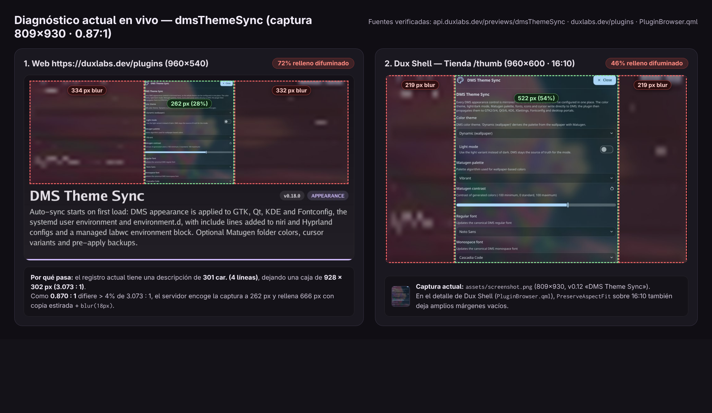
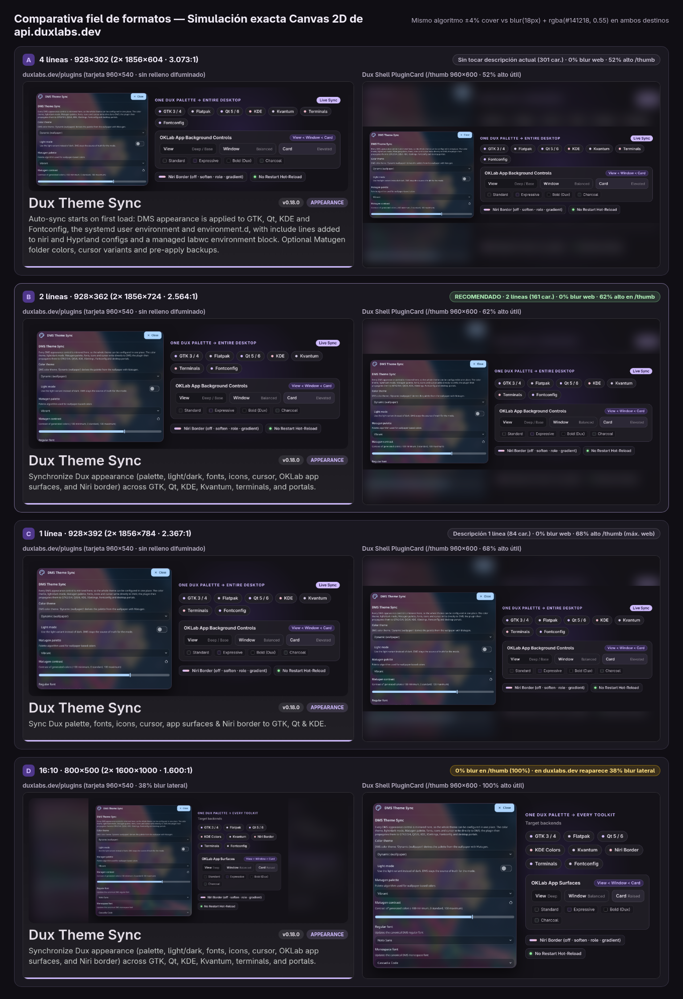
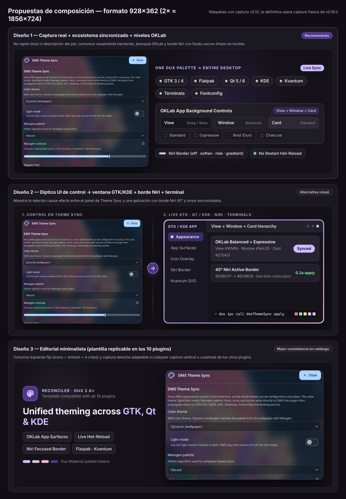

# Ancho óptimo y diseño de imagen para `duxlabs.dev/plugins` — `dms-theme-sync` y catálogo de plugins

Fecha: 2026-11-24

## Resumen ejecutivo

Una sola URL (`screenshot` en `dux-plugin-registry`) alimenta **tres contenedores distintos** en el ecosistema Dux:

1. **Web `https://duxlabs.dev/plugins` (tarjeta `960 × 540`)**: `api.duxlabs.dev/previews/{id}` coloca tu imagen arriba del pie de texto dentro de un rectángulo fijo de **`928 px` de ancho** cuya altura depende del número de líneas de la descripción (`Adwaita Sans 22px`):
   - **1 línea** (≤ ~88 car. / ≤ 928 px): **`928 × 392`** (`AR = 2.367` → 2× **`1856 × 784`**)
   - **2 líneas** (~95–175 car., según ancho de palabra): **`928 × 362`** (`AR = 2.564` → 2× **`1856 × 724`**)
   - **3 líneas** (~180–275 car.): **`928 × 332`** (`AR = 2.795` → 2× **`1856 × 664`**)
   - **4 líneas** (estado vivo actual de `dmsThemeSync`, **301 car.**): **`928 × 302`** (`AR = 3.073` → 2× **`1856 × 604`**)
   - **Regla de relleno difuminado:** si la proporción de tu imagen (`srcAR`) está dentro de **`±4%`** de la proporción de esa caja (`Math.abs(srcAR / regionAR - 1) <= 0.04`), el servidor usa `cover` (**0% de relleno difuminado**). Si se sale de ±4%, usa `contain` y rellena el resto con una copia estirada y `blur(18px)` + velo `#141218` al 55%.
2. **Dux Shell — Tienda (`PluginCard.qml`)**: carga `api.duxlabs.dev/previews/{id}/thumb` (**`960 × 600`**, **`16:10`**, `AR = 1.600`, sin pie) con la misma regla del `±4%` (`1.54`–`1.66` sin blur).
3. **Dux Shell — Panel de detalle (`PluginBrowser.qml`)**: muestra el `screenshot` crudo dentro de una caja **`16:10`** con `PreserveAspectFit` sobre el fondo del tema (sin blur).

**Conclusión práctica:** al diseñar una composición horizontal panorámica en fondo continuo oscuro Dux (`#141218`) al tamaño exacto de `REGION` (recomendado **`1856 × 724`** con descripción de 2 líneas, o **`1856 × 604`** si no se toca la descripción viva de 4 líneas), **`duxlabs.dev/plugins` queda al 100% nítido con 0% de bordes difuminados**, y en **Dux Shell `/thumb` (`16:10`)** las franjas superior e inferior difuminan solo fondo mate oscuro uniforme sin ruido visual.

---

## Diagnóstico actual en vivo (`dmsThemeSync`)

Hoy `assets/screenshot.png` mide **`809 × 930`** (`0.870 : 1`, vertical, captura de v0.12 «DMS Theme Sync») y el registro en línea mantiene `v0.12.4` con descripción de **301 caracteres (4 líneas)**:



- En **`duxlabs.dev/plugins`**: la caja es `928 × 302` (`3.073 : 1`). La captura vertical queda reducida a **`262 px`** de ancho (**28% útil**) rodeada de **`666 px` difuminados (72%)**.
- En **Dux Shell (`/thumb` `960 × 600`)**: la captura ocupa **`522 px`** de ancho (**54% útil**) con **`438 px` difuminados (46%)**.

---

## Comparativa de formatos (A, B, C, D) simulados con el motor real

Todas las pruebas se pasaron por el algoritmo Canvas 2D exacto de `api.duxlabs.dev` / `thumbnail-generator.html` (`Adwaita Sans`, regla `±4%`, `blur(18px)` + `#141218` al 55%):

| Opción | Resolución 2× (base 1×) | AR | Descripción requerida | Web `duxlabs.dev/plugins` | Dux Shell `/thumb` (`16:10`) | ¿Pide PR al registro? |
| :--- | :--- | :---: | :--- | :--- | :--- | :--- |
| **A (4 líneas)** | `1856 × 604` (`928 × 302`) | `3.073` | Actual viva (`301 car.`) | **0% blur** (altura justa) | `52%` alto útil (franjas oscuras limpias arriba/abajo) | Solo imagen / metadata pendiente |
| **B (2 líneas, Rec.)** | **`1856 × 724`** (`928 × 362`) | **`2.564`** | 2 líneas (~`161 car.` en `Adwaita Sans 22px`) | **0% blur**, +20% más alto que A | `62%` alto útil (mejor balance entre ambos sitios) | Sí (descripción 2 líneas + bump `v0.18.0`) |
| **C (1 línea)** | `1856 × 784` (`928 × 392`) | `2.367` | Ultracorta (`84 car.`) | **0% blur**, altura máxima en web | `68%` alto útil | Sí (descripción ultracorta + bump) |
| **D (`16:10` nativo)** | `1600 × 1000` (`800 × 500`) | `1.600` | Cualquiera | Reaparece **`38%` de blur lateral** (`579 / 928 px`) | **100% útil** (0% blur) | Opcional |

> Nota medida en Chromium con `Adwaita Sans 22px`: el texto actual de `packaging/arqueon-dms-theme-sync.json` (`180 car.`) envuelve a **3 líneas (`928 × 332`)** por la última palabra suelta (`"applications."`). Ajustado a **~161 car.** (`"Synchronize Dux appearance (palette, light/dark, fonts, icons, cursor, OKLab app surfaces, and Niri border) across GTK, Qt, KDE, Kvantum, terminals, and portals."`) envuelve exacto a **2 líneas (`928 × 362`)**.



---

## Tres diseños propuestos para `dms-theme-sync`

Las tres propuestas evitan repetir el título grande o el párrafo descriptivo (que ya aparecen en el pie de `duxlabs.dev/plugins`) y usan los tokens visuales nativos de Dux (`#141218`, `#211f24`, `#D0BCFF`, `#4F378B`) con bordes oscuros limpios:



1. **Diseño 1 — Captura real + ecosistema sincronizado + niveles OKLab *(Recomendado)*:** combina la ventana real de ajustes a la izquierda con píldoras de toolkits (`GTK 3/4`, `Flatpak`, `Qt 5/6`, `KDE`, `Kvantum`, `Terminals`, `Fontconfig`), la jerarquía OKLab (`View < Window < Card`) y el indicador del borde de Niri.
2. **Diseño 2 — Díptico UI de control → ventana GTK/KDE + borde Niri:** muestra causa y efecto: controles de Theme Sync a la izquierda conectados a una ventana de app con borde degradado de 45° de Niri y barra ANSI de terminal abajo.
3. **Diseño 3 — Editorial minimalista reutilizable:** estructura de 2 columnas fija (cápsula de ícono, síntesis corta, 4 chips y muestras a la izquierda; captura enmarcada a la derecha) pensada para reutilizarse como plantilla uniforme en todos tus plugins.

*(Nota visual: las maquetas muestran temporalmente la captura `v0.12` solo para validar composición y proporciones; la versión definitiva se tomará en vivo con la interfaz real de `v0.18.0`.)*

---

## Referencia de tus otros 9 plugins en `api.duxlabs.dev`

Medidas verificadas en vivo hoy sobre los 10 plugins publicados por `arqueon`:

| Plugin (`id`) | Descripción viva | `REGION` actual en web (`1×`) | Óptimo `2×` sin tocar descripción | Captura actual en repo |
| :--- | :---: | :---: | :---: | :---: |
| `dmsThemeSync` | 301 car. (4 líneas) | `928 × 302` (`3.073:1`) | `1856 × 604` (ó `1856 × 724` con 2 líneas) | `809 × 930` (`0.870:1`) |
| `dankCalendarAgenda` | 177 car. (2 líneas) | `928 × 362` (`2.564:1`) | `1856 × 724` | `544 × 661` (`0.823:1`) |
| `dmsVikunja` | 162 car. (2 líneas) | `928 × 362` (`2.564:1`) | `1856 × 724` | `781 × 839` (`0.931:1`) |
| `gazeAuth` | 104 car. (2 líneas) | `928 × 362` (`2.564:1`) | `1856 × 724` | `876 × 790` (`1.109:1`) |
| `dankmailUnread` | 165 car. (3 líneas) | `928 × 332` (`2.795:1`) | `1856 × 664` (hoy ya usa 16:9 `2560×1440`) | `2560 × 1440` (`1.778:1`) |
| `ntfy` | 201 car. (3 líneas) | `928 × 332` (`2.795:1`) | `1856 × 664` | `680 × 650` (`1.046:1`) |
| `screenRecorder` | 213 car. (3 líneas) | `928 × 332` (`2.795:1`) | `1856 × 664` | `517 × 849` (`0.609:1`) |
| `wallabag` | 271 car. (3 líneas) | `928 × 332` (`2.795:1`) | `1856 × 664` | `583 × 704` (`0.828:1`) |
| `duxHerdrFleet` | 477 car. (4 líneas) | `928 × 302` (`3.073:1`) | `1856 × 604` | `528 × 662` (`0.798:1`) |
| `lastfmScrobbler` | 355 car. (4 líneas) | `928 × 302` (`3.073:1`) | `1856 × 604` | `370 × 615` (`0.602:1`) |

---

## Decisiones para aplicar en `dms-theme-sync`

:::question
¿Qué proporción y estrategia de descripción usamos para la nueva imagen?

La altura útil de la tarjeta en `duxlabs.dev/plugins` depende directamente de cuántas líneas ocupe la descripción en el registro.

- [ ] Formato B: 2 líneas (1856×724) y ajustar descripción a ~161 car. — 0% blur en web, 20% más altura útil y 62% en /thumb
- [ ] Formato C: 1 línea (1856×784) y descripción ultracorta de ~84 car. — máxima altura posible en duxlabs.dev con 0% blur
- [ ] Formato A: 4 líneas (1856×604) sin cambiar descripción actual — elimina el blur web de inmediato sin tocar la descripción en el registro
- [ ] Formato D: 16:10 (1600×1000) optimizado para Dux Shell — 100% útil en la app, manteniendo ~38% de blur lateral en duxlabs.dev

Recommended: Formato B: 2 líneas (1856×724) y ajustar descripción a ~161 car. — 0% blur en web, 20% más altura útil y 62% en /thumb
:::

:::question
¿Qué propuesta de diseño generamos como base para `assets/screenshot.png`?

Las tres usan el mismo contenedor sin relleno difuminado ni texto duplicado con el pie de tarjeta.

- [ ] Diseño 1: Captura + ecosistema sincronizado + niveles OKLab — resume toolkits, jerarquía View < Window < Card y borde Niri junto al panel real
- [ ] Diseño 2: Díptico UI de control + ventana GTK/KDE sincronizada — enfatiza visualmente el resultado en aplicaciones reales con borde Niri 45°
- [ ] Diseño 3: Editorial minimalista reutilizable — prioriza una plantilla idéntica y ligera para escalar a tus otros 9 plugins

Recommended: Diseño 1: Captura + ecosistema sincronizado + niveles OKLab — resume toolkits, jerarquía View < Window < Card y borde Niri junto al panel real
:::

:::question
¿Con qué captura base y tema de Dux construimos la imagen definitiva?

La guía del registro sugiere capturar sobre el tema púrpura por defecto de Dux cuando sea posible; en tu equipo corre Dux Shell 2.2 con `v0.18.0` recién cargado.

- [ ] Captura fresca de v0.18.0 sobre tema púrpura por defecto de Dux — muestra las opciones nuevas y alinea exactamente con el marco púrpura de duxlabs.dev
- [ ] Captura fresca de v0.18.0 con tu tema activo actual — refleja tal cual tu escritorio actual sin cambiar temporalmente el tema
- [ ] Mantener temporalmente la captura v0.12 incrustada en la maqueta — evita tomar captura nueva del diálogo por ahora

Recommended: Captura fresca de v0.18.0 sobre tema púrpura por defecto de Dux — muestra las opciones nuevas y alinea exactamente con el marco púrpura de duxlabs.dev
:::

:::question
¿Actualizamos también `packaging/` y preparamos la actualización para `dux-plugin-registry`?

En el registro en línea `dmsThemeSync` sigue en `v0.12.4` («DMS Theme Sync»); `/home/ruben/Projects/dms/dms-plugin-registry` está ahora en la rama `update/lastfm-scrobbler-1.5.0`.

- [ ] Actualizar assets/screenshot.png y packaging/ en dms-theme-sync, y crear rama/PR limpio aparte desde main en dms-plugin-registry — sin tocar la rama de lastfm-scrobbler
- [ ] Actualizar solo assets/screenshot.png y packaging/ dentro de dms-theme-sync — deja el cambio listo en el repo sin tocar dms-plugin-registry ni abrir PR todavía

Recommended: Actualizar assets/screenshot.png y packaging/ en dms-theme-sync, y crear rama/PR limpio aparte desde main en dms-plugin-registry — sin tocar la rama de lastfm-scrobbler
:::

:::question
¿Cómo manejamos los otros 9 plugins de `arqueon` en esta ronda?

Cada uno tiene hoy distinta altura (`302`, `332` o `362 px`) según su descripción en el registro.

- [ ] Dejar script/plantilla parametrizable en scratch y aplicar primero solo en dms-theme-sync — validas el resultado real publicado en duxlabs.dev antes de replicar
- [ ] Generar de una vez muestras para los otros 9 plugins con su proporción óptima — revisamos todo el lote en una siguiente compuerta antes de tocar sus repos
- [ ] Solo dms-theme-sync por ahora — no preparar plantilla ni muestras para los demás todavía

Recommended: Dejar script/plantilla parametrizable en scratch y aplicar primero solo en dms-theme-sync — validas el resultado real publicado en duxlabs.dev antes de replicar
:::

:::question-text
Ajustes opcionales antes de renderizar la versión final (controles visibles en la captura, textos en las cápsulas, o detalles de diseño):
:::

## Respuestas (2026-11-24)

> 5 of 6 questions answered (`decision: "annotated"`).

```markdown
# File Feedback

## Answers to your questions

5 of 6 questions answered.

### Q1. ¿Qué proporción y estrategia de descripción usamos para la nueva imagen? (line 86)
Answer: Formato B: 2 líneas (1856×724) y ajustar descripción a ~161 car. (your recommendation)

### Q2. ¿Qué propuesta de diseño generamos como base para `assets/screenshot.png`? (line 99)
Answer: Diseño 3: Editorial minimalista reutilizable

### Q3. ¿Con qué captura base y tema de Dux construimos la imagen definitiva? (line 111)
Answer: Captura fresca de v0.18.0 sobre tema púrpura por defecto de Dux (your recommendation)

### Q4. ¿Actualizamos también `packaging/` y preparamos la actualización para `dux-plugin-registry`? (line 123)
Answer: Actualizar assets/screenshot.png y packaging/ en dms-theme-sync, y crear rama/PR limpio aparte desde main en dms-plugin-registry (your recommendation)

### Q5. ¿Cómo manejamos los otros 9 plugins de `arqueon` en esta ronda? (line 134)
Answer: Generar de una vez muestras para los otros 9 plugins con su proporción óptima

### Unanswered
- Q6. Ajustes opcionales antes de renderizar la versión final (controles visibles en la captura, textos en las cápsulas, o detalles de diseño): (line 146)

---
```
